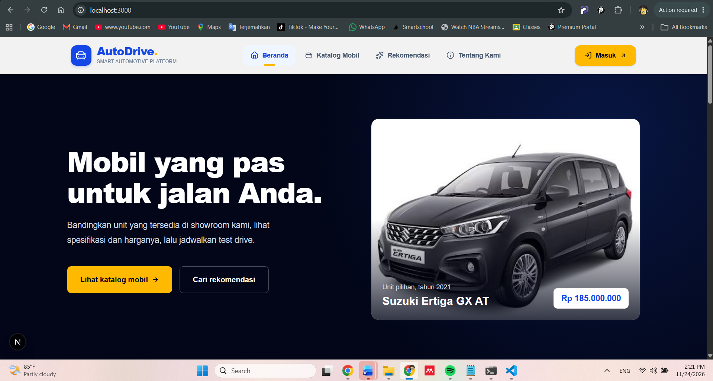
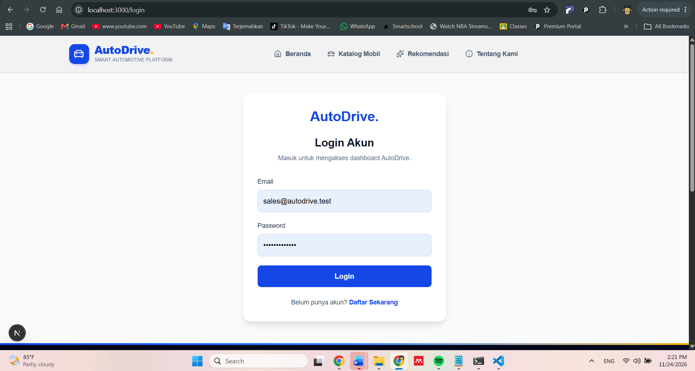
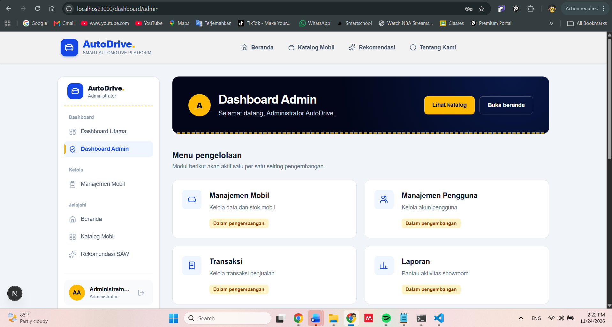
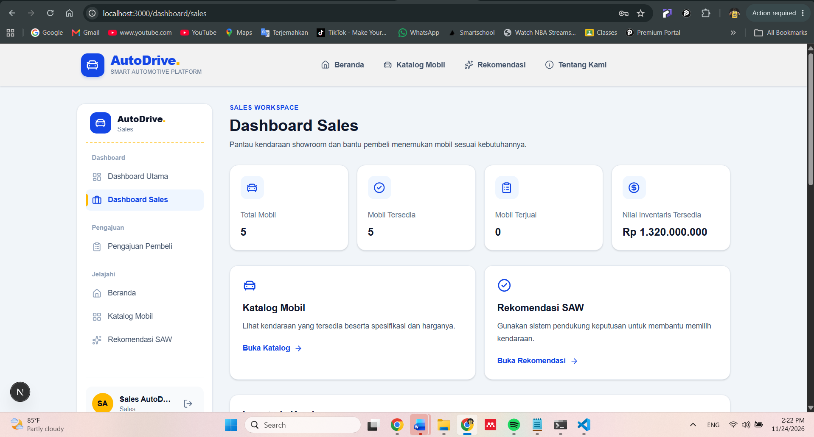
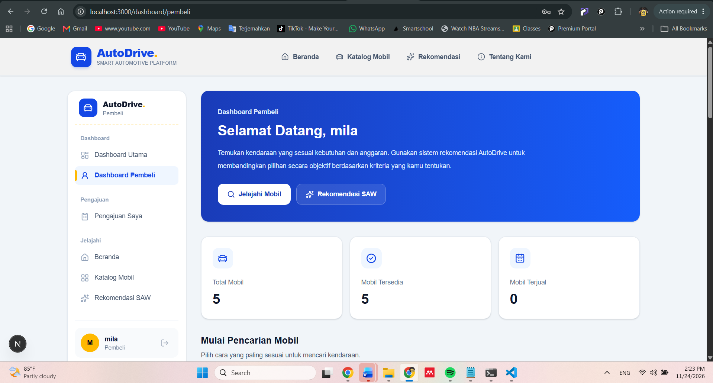
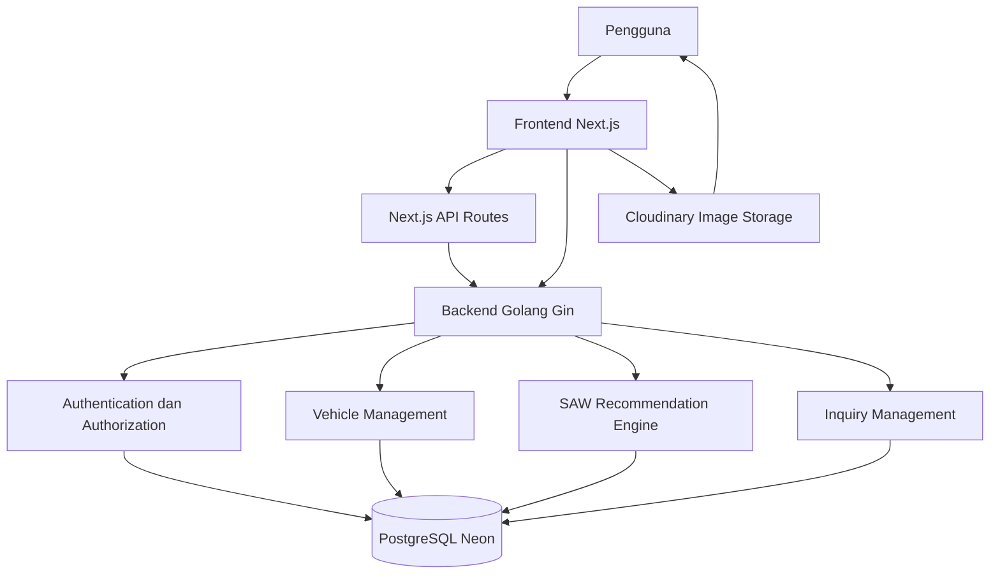
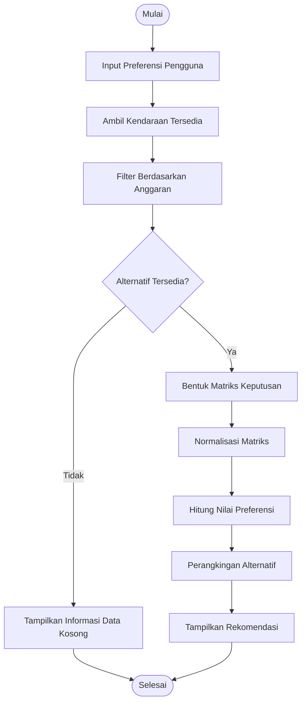
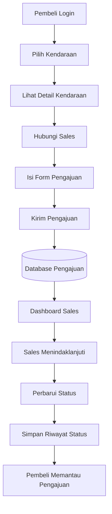
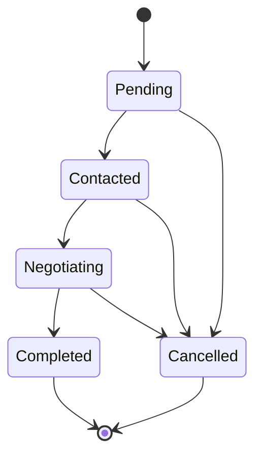
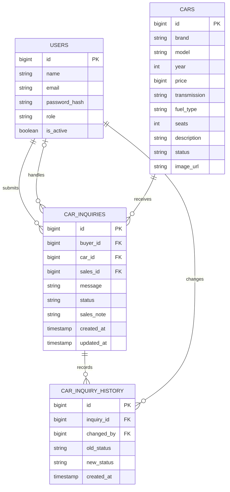

<div align="center">

# AutoDrive

### Sistem Informasi Showroom Mobil dan Sistem Pendukung Keputusan Pemilihan Mobil Menggunakan Metode Simple Additive Weighting (SAW)


**Automotive Information System & Decision Support System**

[Dokumentasi](#daftar-isi) •
[Fitur](#fitur-utama) •
[Screenshot](#dokumentasi-antarmuka) •
[Instalasi](#instalasi)

<br>



</div>

---

## Daftar Isi

- [Tentang AutoDrive](#tentang-autodrive)
- [Latar Belakang](#latar-belakang)
- [Tujuan Pengembangan](#tujuan-pengembangan)
- [Fitur Utama](#fitur-utama)
- [Dokumentasi Antarmuka](#dokumentasi-antarmuka)
- [Teknologi](#teknologi)
- [Arsitektur Sistem](#arsitektur-sistem)
- [Metode SAW](#metode-saw)
- [Analisis Sensitivitas](#analisis-sensitivitas)
- [Alur Pengajuan Minat](#alur-pengajuan-minat)
- [Struktur Database](#struktur-database)
- [Struktur Proyek](#struktur-proyek)
- [Instalasi](#instalasi)
- [Dokumentasi API](#dokumentasi-api)
- [Keamanan Sistem](#keamanan-sistem)
- [Pengujian Sistem](#pengujian-sistem)
- [Status Pengembangan](#status-pengembangan)

---

## Tentang AutoDrive

**AutoDrive** merupakan aplikasi berbasis web yang dikembangkan
untuk mendukung pengelolaan informasi kendaraan pada showroom
mobil serta membantu calon pembeli dalam menentukan pilihan
kendaraan berdasarkan kebutuhan dan preferensi pengguna.

Aplikasi ini mengintegrasikan Sistem Informasi Showroom Mobil
dengan Sistem Pendukung Keputusan (SPK) menggunakan metode
**Simple Additive Weighting (SAW)**.

Metode SAW digunakan untuk menghitung nilai preferensi setiap
alternatif kendaraan berdasarkan kriteria, bobot, dan hasil
normalisasi matriks keputusan.

AutoDrive memiliki tiga peran pengguna utama:

- Admin
- Sales
- Pembeli

Setiap peran memiliki hak akses, tanggung jawab, dan fitur
yang berbeda sesuai kebutuhan sistem.

---

## Latar Belakang

Pemilihan kendaraan melibatkan berbagai pertimbangan, seperti
harga, tahun produksi, kapasitas penumpang, dan jenis transmisi.

Banyaknya alternatif kendaraan dapat menyulitkan calon pembeli
dalam menentukan pilihan yang sesuai dengan kebutuhan dan
anggaran yang tersedia.

AutoDrive dikembangkan untuk menyediakan informasi kendaraan
secara terstruktur serta membantu proses pengambilan keputusan
melalui metode SAW.

Sistem ini juga menyediakan mekanisme pengajuan minat kendaraan
yang memungkinkan pembeli menyampaikan ketertarikan terhadap
kendaraan tertentu kepada tim Sales.

---

## Tujuan Pengembangan

1. Mengembangkan sistem informasi showroom mobil berbasis web.
2. Mendukung pengelolaan data kendaraan secara terstruktur.
3. Mempermudah calon pembeli memperoleh informasi kendaraan.
4. Mengimplementasikan metode Simple Additive Weighting.
5. Menghasilkan rekomendasi kendaraan berdasarkan kriteria
   dan preferensi pengguna.
6. Menyediakan informasi perhitungan rekomendasi yang transparan.
7. Mendukung komunikasi antara pembeli dan Sales melalui
   pengajuan minat kendaraan.
8. Mengimplementasikan pembagian hak akses berdasarkan
   peran pengguna.

---

## Fitur Utama

### Admin

Admin bertanggung jawab terhadap pengelolaan data kendaraan
dan informasi showroom.

- Login dan logout Admin.
- Dashboard Admin.
- Melihat daftar kendaraan.
- Menambahkan data kendaraan.
- Mengubah data kendaraan.
- Menghapus kendaraan sesuai aturan sistem.
- Mengelola harga kendaraan.
- Mengelola spesifikasi kendaraan.
- Mengelola status ketersediaan kendaraan.
- Mengunggah foto kendaraan melalui Cloudinary.

### Sales

Sales bertanggung jawab terhadap tindak lanjut pengajuan
minat kendaraan dari calon pembeli.

- Login dan logout Sales.
- Dashboard Sales.
- Melihat daftar pengajuan pembeli.
- Melihat informasi calon pembeli.
- Melihat kendaraan yang diminati.
- Mengelola status pengajuan.
- Menambahkan catatan internal Sales.
- Melihat riwayat perubahan status.
- Memantau perkembangan pengajuan kendaraan.

### Pembeli

Pembeli dapat memperoleh informasi kendaraan, menggunakan
sistem rekomendasi, dan mengirim pengajuan minat.

- Registrasi akun Pembeli.
- Login dan logout.
- Dashboard Pembeli.
- Melihat katalog kendaraan.
- Melihat detail kendaraan.
- Melihat foto dan spesifikasi kendaraan.
- Menggunakan sistem rekomendasi SAW.
- Menentukan preferensi kendaraan.
- Menentukan anggaran pembelian.
- Melihat hasil perangkingan kendaraan.
- Melihat matriks keputusan.
- Melihat hasil normalisasi.
- Melihat nilai preferensi.
- Menggunakan analisis sensitivitas.
- Menghubungi Sales melalui pengajuan minat.
- Memantau riwayat dan status pengajuan.

### Sistem Pendukung Keputusan

- Penyaringan alternatif berdasarkan anggaran.
- Penentuan kriteria penilaian.
- Pembobotan kriteria.
- Normalisasi atribut cost dan benefit.
- Perhitungan nilai preferensi.
- Perangkingan alternatif kendaraan.
- Penyajian detail perhitungan SAW.
- Analisis sensitivitas bobot kriteria.

---


## Dokumentasi Antarmuka

### 1. Halaman Utama


Halaman utama aplikasi AutoDrive.

---

### 2. Halaman Login



Halaman autentikasi pengguna berdasarkan peran.

---

### 3. Dashboard Admin



Pengelolaan data, harga, foto, dan spesifikasi kendaraan.

---

### 4. Dashboard Sales



Pengelolaan pengajuan minat dan tindak lanjut calon pembeli.

---

### 5. Dashboard Pembeli



Akses katalog kendaraan, rekomendasi SAW, dan riwayat pengajuan.

---


## Teknologi

### Frontend

| Teknologi | Fungsi |
|---|---|
| Next.js | Framework aplikasi web |
| React | Pengembangan antarmuka |
| TypeScript | Bahasa pemrograman frontend |
| Tailwind CSS | Styling dan desain responsif |
| Lucide React | Ikon antarmuka |

### Backend

| Teknologi | Fungsi |
|---|---|
| Golang | Bahasa pemrograman backend |
| Gin | Framework REST API |
| pgx | Koneksi PostgreSQL |
| JWT | Autentikasi pengguna |
| bcrypt | Hashing password |

### Database dan Penyimpanan

| Teknologi | Fungsi |
|---|---|
| PostgreSQL | Database relasional |
| Neon | Layanan database PostgreSQL |
| Cloudinary | Penyimpanan foto kendaraan |

### Development Tools

| Teknologi | Fungsi |
|---|---|
| Visual Studio Code | Code editor |
| Git | Version control |
| GitHub | Repository source code |
| PowerShell | Command-line interface |

---

## Arsitektur Sistem

AutoDrive menggunakan arsitektur client-server dengan
pemisahan antara frontend, backend, database, dan
penyimpanan gambar.



### Frontend

Frontend bertanggung jawab terhadap:

- Penyajian antarmuka pengguna.
- Pengelolaan formulir.
- Navigasi aplikasi.
- Penyajian dashboard.
- Visualisasi hasil rekomendasi.
- Komunikasi dengan backend melalui API.

### Backend

Backend bertanggung jawab terhadap:

- Autentikasi dan otorisasi.
- Validasi data.
- Pengelolaan kendaraan.
- Pengelolaan pengajuan minat.
- Perhitungan metode SAW.
- Komunikasi dengan database.

### Database

Database PostgreSQL digunakan untuk menyimpan informasi
pengguna, kendaraan, pengajuan minat, dan riwayat
perubahan status.

### Cloudinary

Cloudinary digunakan sebagai layanan penyimpanan dan
penyedia akses terhadap foto kendaraan.

---

## Metode SAW

Simple Additive Weighting (SAW) merupakan metode
pengambilan keputusan multikriteria yang menggunakan
penjumlahan terbobot dari nilai kriteria yang telah
dinormalisasi.

Metode ini digunakan untuk menentukan peringkat alternatif
kendaraan berdasarkan kriteria dan preferensi pengguna.

### Kriteria Penilaian

| Kode | Kriteria | Jenis Atribut | Bobot Default |
|---|---|---|---:|
| C1 | Harga kendaraan | Cost | 40% |
| C2 | Tahun produksi | Benefit | 25% |
| C3 | Kapasitas penumpang | Benefit | 20% |
| C4 | Kesesuaian transmisi | Benefit | 15% |
| | **Total** | | **100%** |

### Interpretasi Kriteria

**Harga kendaraan**

Harga merupakan atribut cost. Kendaraan dengan harga
lebih rendah memperoleh nilai normalisasi lebih tinggi
pada kriteria harga.

**Tahun produksi**

Tahun produksi merupakan atribut benefit. Kendaraan
dengan tahun produksi lebih baru memperoleh nilai
normalisasi lebih tinggi pada kriteria tersebut.

**Kapasitas penumpang**

Kapasitas penumpang merupakan atribut benefit.
Kendaraan dengan kapasitas lebih besar memperoleh
nilai normalisasi lebih tinggi.

**Kesesuaian transmisi**

Kriteria transmisi dinilai berdasarkan kesesuaian
jenis transmisi kendaraan dengan preferensi pengguna.

### Tahapan Perhitungan SAW

1. Menentukan alternatif kendaraan.
2. Menentukan kriteria penilaian.
3. Menentukan bobot setiap kriteria.
4. Menyaring kendaraan berdasarkan anggaran.
5. Membentuk matriks keputusan.
6. Melakukan normalisasi matriks.
7. Menghitung nilai preferensi.
8. Mengurutkan alternatif berdasarkan nilai preferensi.
9. Menampilkan hasil rekomendasi.

### Normalisasi Atribut Benefit

$$
r_{ij} = \frac{x_{ij}}{\max_i(x_{ij})}
$$

### Normalisasi Atribut Cost

$$
r_{ij} = \frac{\min_i(x_{ij})}{x_{ij}}
$$

Keterangan:

- $r_{ij}$: nilai normalisasi alternatif.
- $x_{ij}$: nilai alternatif pada suatu kriteria.
- $\max_i(x_{ij})$: nilai maksimum pada kriteria.
- $\min_i(x_{ij})$: nilai minimum pada kriteria.

### Penilaian Kesesuaian Transmisi

| Kondisi | Nilai |
|---|---:|
| Transmisi sesuai preferensi | 1,0 |
| Transmisi tidak sesuai preferensi | 0,5 |
| Tidak memiliki preferensi transmisi | 1,0 |

### Perhitungan Nilai Preferensi

$$
V_i = \sum_{j=1}^{n} w_j r_{ij}
$$

Keterangan:

- $V_i$: nilai preferensi alternatif ke-i.
- $w_j$: bobot kriteria ke-j.
- $r_{ij}$: nilai normalisasi alternatif.
- $n$: jumlah kriteria.

Alternatif dengan nilai preferensi tertinggi menempati
peringkat pertama berdasarkan kriteria dan bobot yang
digunakan.

Hasil rekomendasi merupakan alat bantu pengambilan
keputusan dan tidak menggantikan keputusan akhir pengguna.

### Flowchart Rekomendasi



---

## Analisis Sensitivitas

Analisis sensitivitas digunakan untuk mengamati perubahan
nilai preferensi dan peringkat alternatif ketika bobot
kriteria mengalami perubahan.

Fitur ini membantu pengguna memahami pengaruh perubahan
prioritas penilaian terhadap hasil rekomendasi kendaraan.

Skenario analisis dapat mencakup:

| Skenario | Harga | Tahun | Kapasitas | Transmisi |
|---|---:|---:|---:|---:|
| Bobot Default | 40% | 25% | 20% | 15% |
| Prioritas Harga | 70% | 10% | 10% | 10% |
| Prioritas Tahun | 10% | 70% | 10% | 10% |
| Prioritas Kapasitas | 10% | 10% | 70% | 10% |
| Prioritas Transmisi | 10% | 10% | 10% | 70% |

Setiap skenario menghasilkan nilai preferensi berdasarkan
bobot yang digunakan.

Perubahan peringkat menunjukkan bahwa hasil rekomendasi
dapat dipengaruhi oleh perubahan prioritas pengguna.

---

## Alur Pengajuan Minat

Fitur pengajuan minat memungkinkan pembeli menyampaikan
ketertarikan terhadap kendaraan kepada tim Sales.



### Status Pengajuan

| Status | Keterangan |
|---|---|
| `pending` | Menunggu tindak lanjut Sales |
| `contacted` | Pembeli telah dihubungi |
| `negotiating` | Dalam proses negosiasi |
| `completed` | Pengajuan selesai |
| `cancelled` | Pengajuan dibatalkan |

### Ilustrasi Alur Status



Diagram tersebut menggambarkan contoh alur tindak lanjut
pengajuan. Diagram bukan representasi lengkap dari seluruh
aturan transisi status yang diterapkan backend.

Status pengajuan selesai tidak secara otomatis berarti
kendaraan telah terjual.

---

## Struktur Database

AutoDrive menggunakan PostgreSQL sebagai database utama.

### Tabel Utama

| Tabel | Fungsi |
|---|---|
| `users` | Menyimpan informasi akun pengguna |
| `cars` | Menyimpan informasi kendaraan |
| `car_inquiries` | Menyimpan pengajuan minat kendaraan |
| `car_inquiry_history` | Menyimpan riwayat perubahan status |

### Entity Relationship Diagram



ERD tersebut menyajikan struktur logis tabel utama.
Detail tipe data, constraint, indeks, dan trigger
mengikuti skema database yang digunakan aplikasi.

---

## Struktur Proyek

```text
autodrive/
│
├── backend/
│   ├── cmd/
│   │   ├── createadmin/
│   │   ├── createsales/
│   │   └── resetadmin/
│   │
│   ├── handlers/
│   │   ├── auth.go
│   │   ├── cars.go
│   │   ├── inquiry.go
│   │   ├── recommendation.go
│   │   └── sensitivity.go
│   │
│   ├── middleware/
│   │   └── auth.go
│   │
│   ├── recommendation/
│   │   ├── saw.go
│   │   ├── saw_test.go
│   │   └── sensitivity.go
│   │
│   ├── tools/
│   ├── go.mod
│   ├── go.sum
│   └── main.go
│
├── frontend/
│   ├── app/
│   │   ├── api/
│   │   ├── dashboard/
│   │   │   ├── admin/
│   │   │   ├── sales/
│   │   │   └── pembeli/
│   │   ├── login/
│   │   ├── register/
│   │   ├── mobil/
│   │   ├── rekomendasi/
│   │   ├── tentang-kami/
│   │   ├── globals.css
│   │   ├── layout.tsx
│   │   └── page.tsx
│   │
│   ├── components/
│   │   ├── admin/
│   │   ├── dashboard/
│   │   ├── inquiries/
│   │   ├── recommendation/
│   │   ├── Navbar.tsx
│   │   └── Footer.tsx
│   │
│   ├── lib/
│   │   ├── auth.ts
│   │   └── inquiry-api.ts
│   │
│   ├── public/
│   ├── next.config.ts
│   ├── package.json
│   └── package-lock.json
│
├── docs/
│   └── screenshots/
│       ├── dashboard.png
│       ├── login.png
│       ├── admin.png
│       ├── sales.png
│       └── pembeli.png
│
├── .gitignore
└── README.md
```

---

## Instalasi

### Prasyarat

Pastikan perangkat memiliki:

- Git.
- Go sesuai versi pada `backend/go.mod`.
- Node.js yang kompatibel dengan Next.js proyek.
- npm.
- Database PostgreSQL.
- Akun Cloudinary untuk fitur pengunggahan gambar.

### 1. Clone Repository

```bash
git clone https://github.com/ermilaamanda102/autodrive.git
cd autodrive
```

Apabila repository bersifat private, pengguna harus
memiliki izin akses.

### 2. Instalasi Backend

```bash
cd backend
go mod download
```

### 3. Konfigurasi Environment Backend

Buat file:

```text
backend/.env
```

Tambahkan konfigurasi berikut:

```env
DATABASE_URL=YOUR_POSTGRESQL_CONNECTION_STRING
JWT_SECRET=YOUR_SECURE_RANDOM_SECRET
PORT=8080
```

Gunakan JWT Secret yang kuat dengan panjang minimal
32 karakter.

Pastikan database telah memiliki skema tabel yang
sesuai dengan kebutuhan aplikasi.

### 4. Jalankan Backend

```bash
go run .
```

Backend berjalan pada:

```text
http://localhost:8080
```

Health check:

```text
http://localhost:8080/api/health
```

### 5. Instalasi Frontend

Buka terminal baru dari folder utama proyek.

```bash
cd frontend
npm ci
```

### 6. Konfigurasi Environment Frontend

Buat file:

```text
frontend/.env.local
```

Tambahkan:

```env
API_URL=http://127.0.0.1:8080
```

Untuk fitur pengunggahan foto, tambahkan kredensial
Cloudinary sesuai nama environment variable yang digunakan
pada kode `frontend/app/api/admin/upload/route.ts`.

### 7. Jalankan Frontend

```bash
npm run dev
```

Buka aplikasi melalui browser:

```text
http://localhost:3000
```

### Alamat Halaman

| Halaman | URL |
|---|---|
| Beranda | http://localhost:3000 |
| Login | http://localhost:3000/login |
| Registrasi | http://localhost:3000/register |
| Katalog | http://localhost:3000/mobil |
| Rekomendasi | http://localhost:3000/rekomendasi |
| Dashboard Admin | http://localhost:3000/dashboard/admin |
| Dashboard Sales | http://localhost:3000/dashboard/sales |
| Dashboard Pembeli | http://localhost:3000/dashboard/pembeli |

Dashboard memerlukan autentikasi dan hak akses
yang sesuai.

---

## Dokumentasi API

Dokumentasi berikut mencakup endpoint utama backend AutoDrive.

### Health Check

| Method | Endpoint | Akses |
|---|---|---|
| GET | `/api/health` | Public |

### Authentication

| Method | Endpoint | Akses |
|---|---|---|
| POST | `/api/auth/register` | Public |
| POST | `/api/auth/login` | Public |
| GET | `/api/auth/me` | Authenticated |

### Public Vehicles

| Method | Endpoint | Akses |
|---|---|---|
| GET | `/api/cars` | Public |
| GET | `/api/cars/:id` | Public |

### Recommendation

| Method | Endpoint | Akses |
|---|---|---|
| POST | `/api/recommendations` | Public |

### Admin Vehicles

| Method | Endpoint | Akses |
|---|---|---|
| GET | `/api/admin/cars` | Admin |
| POST | `/api/admin/cars` | Admin |
| PUT | `/api/admin/cars/:id` | Admin |
| DELETE | `/api/admin/cars/:id` | Admin |

### Buyer Inquiries

| Method | Endpoint | Akses |
|---|---|---|
| POST | `/api/inquiries` | Buyer |
| GET | `/api/inquiries/my` | Buyer |

### Sales Inquiries

| Method | Endpoint | Akses |
|---|---|---|
| GET | `/api/sales/inquiries` | Sales |
| GET | `/api/sales/inquiries/:id` | Sales |
| GET | `/api/sales/inquiries/:id/internal` | Sales |
| GET | `/api/sales/inquiries/:id/history` | Sales |
| PATCH | `/api/sales/inquiries/:id` | Sales |

### Authentication Header

Endpoint backend yang memerlukan autentikasi menggunakan
JWT melalui header Authorization.

```http
Authorization: Bearer YOUR_ACCESS_TOKEN
```

---

## Keamanan Sistem

AutoDrive menerapkan beberapa mekanisme keamanan dasar
untuk mendukung pengelolaan akses pengguna.

### Authentication

- Autentikasi menggunakan JSON Web Token.
- Hashing password menggunakan bcrypt.
- Pemeriksaan validitas token.
- Pemeriksaan status akun pengguna.

### Authorization

- Role-Based Access Control (RBAC).
- Pembatasan akses berdasarkan peran.
- Middleware autentikasi pada endpoint yang dilindungi.
- Pembatasan akses pengajuan milik Pembeli.
- Pembatasan pembaruan pengajuan oleh Sales.

### Data Validation

- Validasi input pengguna.
- Validasi ID kendaraan.
- Validasi status pengajuan.
- Validasi panjang pesan pengajuan.
- Validasi catatan internal Sales.
- Parameterized query untuk operasi database.

### Environment Security

File berikut tidak disimpan dalam repository GitHub:

```text
backend/.env
frontend/.env.local
```

Jangan menyimpan informasi berikut secara langsung
di dalam source code:

- Password database.
- JWT Secret.
- Cloudinary API Secret.
- Access token.
- Password akun pengguna.

Mekanisme keamanan tersebut tetap memerlukan pengujian
dan evaluasi lanjutan.

---

## Pengujian Sistem

### Unit Testing Backend

```bash
cd backend
go test ./...
```

### Pengujian Algoritma SAW

```bash
go test -v ./recommendation/...
```

### Kompilasi Backend

```bash
go build .
```

### Pemeriksaan TypeScript

```bash
cd frontend
npx tsc --noEmit
```

### Production Build

```bash
npm run build
```

### Status Pengujian

| Pengujian | Status |
|---|---|
| Kompilasi backend | Berhasil pada pengujian lokal |
| Unit test SAW | Lulus pada pengujian lokal |
| Pemeriksaan TypeScript | Berhasil pada pengujian lokal |
| Production build Next.js | Memerlukan perbaikan dan pengujian ulang |
| Pengujian integrasi | Memerlukan dokumentasi lanjutan |
| Pengujian Black Box | Belum didokumentasikan secara lengkap |
| Pengujian keamanan | Memerlukan validasi lanjutan |

Status tersebut didasarkan pada hasil pengujian yang
telah dilakukan selama pengembangan dan perlu diperbarui
setelah pengujian berikutnya.

---

## Status Pengembangan

AutoDrive berada dalam tahap pengembangan dan
penyempurnaan sistem.

### Fitur yang Telah Diimplementasikan

- [x] Struktur frontend Next.js.
- [x] Struktur backend Golang.
- [x] Integrasi PostgreSQL Neon.
- [x] Autentikasi JWT.
- [x] Role-Based Access Control.
- [x] Dashboard Admin.
- [x] Dashboard Sales.
- [x] Dashboard Pembeli.
- [x] CRUD data kendaraan.
- [x] Integrasi Cloudinary.
- [x] Katalog kendaraan.
- [x] Detail kendaraan.
- [x] Sistem rekomendasi SAW.
- [x] Matriks keputusan.
- [x] Normalisasi kriteria.
- [x] Perangkingan alternatif.
- [x] Analisis sensitivitas.
- [x] Pengajuan minat kendaraan.
- [x] Pengelolaan pengajuan Sales.
- [x] Riwayat perubahan status.
- [x] Repository GitHub.
- [x] Dokumentasi README.

### Rencana Pengembangan Selanjutnya

- [ ] Penyempurnaan UI/UX.
- [ ] Dokumentasi pengujian Black Box.
- [ ] Pengujian integrasi secara menyeluruh.
- [ ] Validasi keamanan sistem.
- [ ] Dokumentasi SQL migration.
- [ ] Penyempurnaan dokumentasi API.
- [ ] Perbaikan production build.
- [ ] Optimalisasi performa aplikasi.
- [ ] Finalisasi dokumentasi penelitian.

---

## Kontribusi

Pengembangan AutoDrive dapat dilakukan melalui proses
version control menggunakan Git.

```bash
git add .
git commit -m "Update AutoDrive"
git push
```

Pastikan perubahan telah diperiksa dan tidak menyertakan
file environment maupun informasi rahasia sebelum
melakukan commit.

---

## Repository

Source code AutoDrive tersedia melalui GitHub:

**https://github.com/ermilaamanda102/autodrive**

---

<div align="center">

# AutoDrive

**Automotive Information System & Decision Support System**

Built with Next.js, TypeScript, Golang, PostgreSQL,
Tailwind CSS, and Cloudinary.

Dikembangkan sebagai proyek sistem informasi showroom
mobil dan implementasi metode Simple Additive Weighting.

**© 2026 AutoDrive**

</div>
