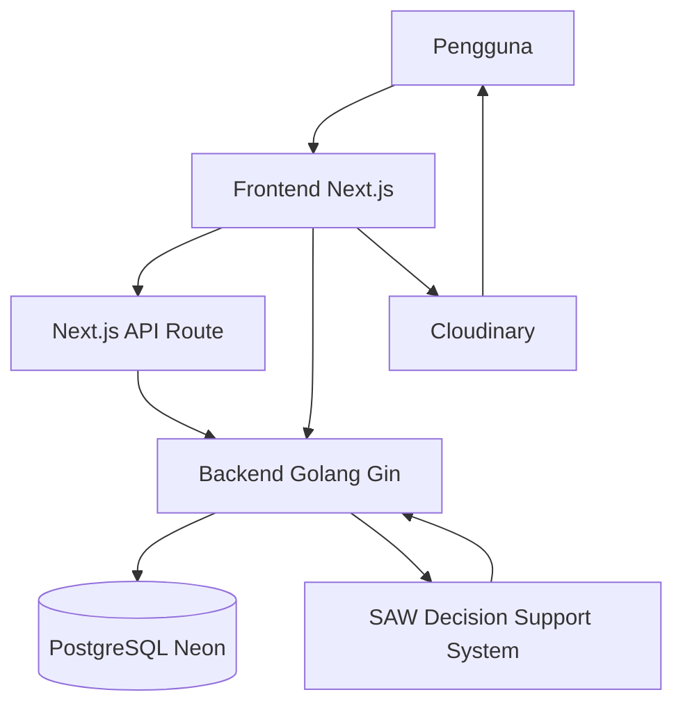
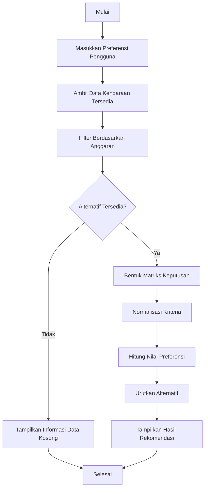
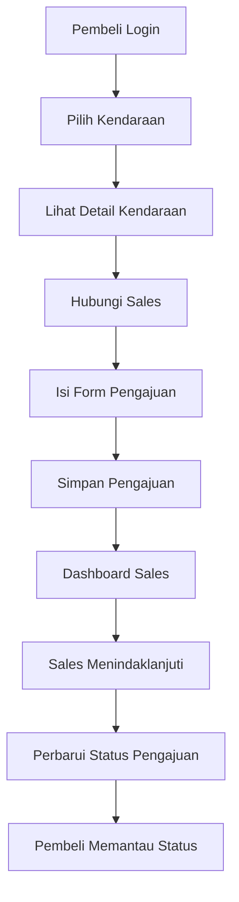

<div align="center">

# AUTODRIVE

### Sistem Informasi Showroom Mobil dan Sistem Pendukung Keputusan Pemilihan Mobil Menggunakan Metode Simple Additive Weighting (SAW)


**Automotive Information System & Decision Support System**

</div>

---

## Daftar Isi

- [Tentang AutoDrive](#tentang-autodrive)
- [Tujuan Pengembangan](#tujuan-pengembangan)
- [Fitur Utama](#fitur-utama)
- [Teknologi](#teknologi)
- [Arsitektur Sistem](#arsitektur-sistem)
- [Metode SAW](#metode-saw)
- [Struktur Proyek](#struktur-proyek)
- [Instalasi](#instalasi)
- [Dokumentasi API](#dokumentasi-api)
- [Dokumentasi Antarmuka](#dokumentasi-antarmuka)
- [Pengujian Sistem](#pengujian-sistem)
- [Status Pengembangan](#status-pengembangan)

---

## Tentang AutoDrive

AutoDrive merupakan aplikasi berbasis web yang dikembangkan untuk mendukung pengelolaan informasi kendaraan pada showroom mobil serta membantu calon pembeli menentukan pilihan kendaraan berdasarkan kriteria dan preferensi pengguna.

Aplikasi ini mengintegrasikan sistem informasi showroom dengan Sistem Pendukung Keputusan (SPK) menggunakan metode Simple Additive Weighting (SAW).

Metode SAW digunakan untuk menghitung nilai preferensi setiap alternatif kendaraan berdasarkan normalisasi matriks keputusan dan pembobotan kriteria.

AutoDrive memiliki tiga peran pengguna, yaitu Admin, Sales, dan Pembeli, dengan hak akses serta fungsi yang berbeda.

---

## Tujuan Pengembangan

1. Mendukung pengelolaan informasi kendaraan secara terstruktur.
2. Mempermudah calon pembeli dalam memperoleh informasi kendaraan.
3. Membantu pengguna menentukan alternatif kendaraan berdasarkan kriteria yang ditetapkan.
4. Mengimplementasikan metode SAW dalam proses rekomendasi kendaraan.
5. Mendukung komunikasi antara pembeli dan Sales melalui pengajuan minat kendaraan.
6. Menyediakan informasi perhitungan rekomendasi yang dapat ditelusuri oleh pengguna.

---

## Fitur Utama

### Admin

- Autentikasi dan otorisasi Admin.
- Dashboard pengelolaan kendaraan.
- Penambahan data mobil.
- Perubahan data mobil.
- Penghapusan data mobil sesuai aturan sistem.
- Pengelolaan harga dan spesifikasi kendaraan.
- Pengelolaan status ketersediaan kendaraan.
- Pengunggahan foto kendaraan melalui Cloudinary.

### Sales

- Autentikasi dan otorisasi Sales.
- Dashboard Sales.
- Melihat daftar pengajuan minat kendaraan.
- Melihat informasi calon pembeli.
- Mengelola status pengajuan.
- Menambahkan catatan internal Sales.
- Melihat riwayat perubahan status pengajuan.

### Pembeli

- Registrasi akun.
- Login dan logout.
- Dashboard Pembeli.
- Melihat katalog kendaraan.
- Melihat detail dan spesifikasi kendaraan.
- Memperoleh rekomendasi kendaraan menggunakan SAW.
- Melihat matriks keputusan dan hasil normalisasi.
- Melihat nilai preferensi dan peringkat alternatif.
- Melakukan analisis sensitivitas bobot kriteria.
- Mengirim pengajuan minat kendaraan.
- Memantau perkembangan pengajuan.

### Sistem Pendukung Keputusan

- Penyaringan alternatif berdasarkan anggaran.
- Pembobotan kriteria.
- Normalisasi atribut cost dan benefit.
- Perhitungan nilai preferensi.
- Perangkingan alternatif kendaraan.
- Penyajian detail perhitungan.
- Analisis sensitivitas bobot kriteria.

---

## Teknologi

| Teknologi | Fungsi |
|---|---|
| Next.js | Framework frontend |
| React | Pengembangan antarmuka |
| TypeScript | Bahasa pemrograman frontend |
| Tailwind CSS | Styling antarmuka |
| Lucide React | Ikon antarmuka |
| Golang | Bahasa pemrograman backend |
| Gin | Framework REST API |
| PostgreSQL | Database relasional |
| Neon | Layanan database PostgreSQL |
| Cloudinary | Penyimpanan foto kendaraan |
| JWT | Autentikasi pengguna |
| Git | Version control |
| GitHub | Repository source code |

---

## Arsitektur Sistem

AutoDrive menggunakan arsitektur client-server dengan pemisahan frontend, backend, dan database.



### Frontend

Frontend bertanggung jawab terhadap penyajian antarmuka, interaksi pengguna, formulir, dashboard, dan visualisasi hasil rekomendasi.

### Backend

Backend bertanggung jawab terhadap autentikasi, otorisasi, validasi data, pengelolaan kendaraan, pengajuan minat, serta perhitungan rekomendasi SAW.

### Database

PostgreSQL digunakan untuk menyimpan data pengguna, kendaraan, pengajuan minat, dan riwayat perubahan status.

### Penyimpanan Gambar

Cloudinary digunakan untuk menyimpan dan menyediakan akses terhadap foto kendaraan.

---

## Metode SAW

Simple Additive Weighting merupakan metode pengambilan keputusan multikriteria yang menghitung nilai preferensi alternatif berdasarkan penjumlahan terbobot dari nilai kriteria yang telah dinormalisasi.

### Kriteria Penilaian

| Kode | Kriteria | Jenis | Bobot Default |
|---|---|---|---:|
| C1 | Harga kendaraan | Cost | 40% |
| C2 | Tahun produksi | Benefit | 25% |
| C3 | Kapasitas penumpang | Benefit | 20% |
| C4 | Kesesuaian transmisi | Benefit | 15% |
| | Total | | 100% |

Harga yang lebih rendah memperoleh nilai preferensi lebih tinggi pada kriteria cost.

Tahun produksi dan kapasitas penumpang dinilai menggunakan atribut benefit.

Kesesuaian transmisi ditentukan berdasarkan preferensi transmisi pengguna.

### Tahapan Perhitungan

1. Menentukan alternatif kendaraan yang tersedia.
2. Menyaring alternatif berdasarkan anggaran pengguna.
3. Menentukan nilai dan bobot setiap kriteria.
4. Membentuk matriks keputusan.
5. Melakukan normalisasi matriks keputusan.
6. Menghitung nilai preferensi setiap alternatif.
7. Mengurutkan alternatif berdasarkan nilai preferensi.

### Normalisasi Atribut Benefit

$$
r_{ij} = \frac{x_{ij}}{\max_i x_{ij}}
$$

### Normalisasi Atribut Cost

$$
r_{ij} = \frac{\min_i x_{ij}}{x_{ij}}
$$

### Kesesuaian Transmisi

Implementasi AutoDrive menggunakan nilai kesesuaian transmisi:

- Transmisi sesuai preferensi: 1,0.
- Transmisi tidak sesuai preferensi: 0,5.
- Tidak memiliki preferensi transmisi: 1,0.

### Nilai Preferensi

$$
V_i = \sum_{j=1}^{n} w_j r_{ij}
$$

Keterangan:

- V_i: nilai preferensi alternatif.
- w_j: bobot kriteria.
- r_ij: nilai kriteria yang telah dinormalisasi.
- n: jumlah kriteria.

Alternatif dengan nilai preferensi tertinggi menempati peringkat pertama berdasarkan kriteria dan bobot yang digunakan.

Hasil rekomendasi merupakan alat bantu pengambilan keputusan, bukan pengganti keputusan akhir pengguna.

### Analisis Sensitivitas

Analisis sensitivitas digunakan untuk mengamati perubahan nilai preferensi dan peringkat kendaraan ketika bobot kriteria diubah.

Fitur ini membantu pengguna memahami pengaruh perubahan prioritas terhadap hasil rekomendasi.

---

## Alur Rekomendasi Kendaraan



---

## Alur Pengajuan Minat



### Status Pengajuan

| Status | Keterangan |
|---|---|
| pending | Menunggu tindak lanjut Sales |
| contacted | Pembeli telah dihubungi |
| negotiating | Dalam proses negosiasi |
| completed | Pengajuan selesai |
| cancelled | Pengajuan dibatalkan |

---

## Struktur Proyek

```text
autodrive/
│
├── backend/
│   ├── cmd/
│   ├── handlers/
│   │   ├── auth.go
│   │   ├── cars.go
│   │   ├── inquiry.go
│   │   ├── recommendation.go
│   │   └── sensitivity.go
│   ├── middleware/
│   │   └── auth.go
│   ├── recommendation/
│   │   ├── saw.go
│   │   ├── saw_test.go
│   │   └── sensitivity.go
│   ├── tools/
│   ├── go.mod
│   ├── go.sum
│   └── main.go
│
├── frontend/
│   ├── app/
│   │   ├── api/
│   │   ├── dashboard/
│   │   ├── login/
│   │   ├── register/
│   │   ├── mobil/
│   │   ├── rekomendasi/
│   │   ├── tentang-kami/
│   │   ├── globals.css
│   │   ├── layout.tsx
│   │   └── page.tsx
│   ├── components/
│   │   ├── admin/
│   │   ├── dashboard/
│   │   ├── inquiries/
│   │   └── recommendation/
│   ├── lib/
│   ├── public/
│   ├── package.json
│   └── next.config.ts
│
├── .gitignore
└── README.md
```

---

## Instalasi

### Prasyarat

Pastikan perangkat memiliki:

- Git.
- Go sesuai versi yang ditentukan pada go.mod.
- Node.js yang kompatibel dengan versi Next.js proyek.
- npm.
- Database PostgreSQL.
- Akun Cloudinary untuk fitur pengunggahan gambar.

### 1. Clone Repository

```bash
git clone https://github.com/ermilaamanda102/autodrive.git
cd autodrive
```

Apabila repository bersifat private, pengguna harus memiliki izin akses.

### 2. Konfigurasi Backend

Masuk ke folder backend.

```bash
cd backend
go mod download
```

Buat file `.env` pada folder backend.

```env
DATABASE_URL=YOUR_POSTGRESQL_CONNECTION_STRING
JWT_SECRET=YOUR_SECURE_RANDOM_SECRET
PORT=8080
```

JWT_SECRET harus memiliki minimal 32 karakter dan menggunakan nilai rahasia yang kuat.

Database harus memiliki skema tabel yang sesuai dengan kebutuhan aplikasi sebelum backend dijalankan.

### 3. Jalankan Backend

```bash
go run .
```

Backend dapat diakses melalui:

```text
http://localhost:8080
```

Endpoint pemeriksaan layanan:

```text
http://localhost:8080/api/health
```

### 4. Konfigurasi Frontend

Buka terminal baru dan masuk ke folder frontend.

```bash
cd frontend
npm ci
```

Buat file `.env.local`.

```env
API_URL=http://127.0.0.1:8080
```

Tambahkan konfigurasi Cloudinary sesuai nama environment variable yang digunakan pada kode pengunggahan gambar.

### 5. Jalankan Frontend

```bash
npm run dev
```

Frontend dapat diakses melalui:

```text
http://localhost:3000
```

### Keamanan Environment

File `.env` dan `.env.local` tidak boleh diunggah ke repository.

Jangan menyimpan password database, JWT Secret, API Secret Cloudinary, maupun password pengguna secara langsung di source code.

---

## Dokumentasi API

### Authentication

| Method | Endpoint | Akses |
|---|---|---|
| POST | /api/auth/register | Public |
| POST | /api/auth/login | Public |
| GET | /api/auth/me | Authenticated |

### Public Vehicles

| Method | Endpoint | Akses |
|---|---|---|
| GET | /api/cars | Public |
| GET | /api/cars/:id | Public |
| POST | /api/recommendations | Public |

### Admin Vehicles

| Method | Endpoint | Akses |
|---|---|---|
| GET | /api/admin/cars | Admin |
| POST | /api/admin/cars | Admin |
| PUT | /api/admin/cars/:id | Admin |
| DELETE | /api/admin/cars/:id | Admin |

### Buyer Inquiries

| Method | Endpoint | Akses |
|---|---|---|
| POST | /api/inquiries | Buyer |
| GET | /api/inquiries/my | Buyer |

### Sales Inquiries

| Method | Endpoint | Akses |
|---|---|---|
| GET | /api/sales/inquiries | Sales |
| GET | /api/sales/inquiries/:id | Sales |
| GET | /api/sales/inquiries/:id/internal | Sales |
| GET | /api/sales/inquiries/:id/history | Sales |
| PATCH | /api/sales/inquiries/:id | Sales |

Endpoint yang membutuhkan autentikasi menggunakan JWT melalui header Authorization.

```text
Authorization: Bearer YOUR_ACCESS_TOKEN
```

---

## Dokumentasi Antarmuka

Dokumentasi screenshot aplikasi akan ditambahkan pada folder `docs/screenshots`.

Halaman yang didokumentasikan meliputi:

- Halaman beranda.
- Halaman login.
- Halaman registrasi.
- Katalog kendaraan.
- Detail kendaraan.
- Form rekomendasi.
- Hasil rekomendasi SAW.
- Matriks perhitungan SAW.
- Analisis sensitivitas.
- Dashboard Admin.
- Dashboard Sales.
- Dashboard Pembeli.
- Form pengajuan minat.
- Riwayat pengajuan.

---

## Pengujian Sistem

### Pengujian Backend

```bash
cd backend
go test ./...
```

### Kompilasi Backend

```bash
go build .
```

### Pemeriksaan TypeScript

```bash
cd frontend
npx tsc --noEmit
```

### Production Build Frontend

```bash
npm run build
```

### Status Pengujian

| Pengujian | Status |
|---|---|
| Kompilasi backend | Berhasil pada pengujian lokal |
| Unit test algoritma SAW | Lulus pada pengujian lokal |
| Pemeriksaan TypeScript | Berhasil pada pengujian lokal |
| Production build frontend | Memerlukan perbaikan dan pengujian ulang |
| Pengujian Black Box | Belum didokumentasikan secara lengkap |
| Pengujian keamanan | Memerlukan validasi lanjutan |

Status pengujian perlu diperbarui berdasarkan hasil pengujian aktual.

---

## Status Pengembangan

AutoDrive berada dalam tahap pengembangan dan penyempurnaan sistem.

Fokus pengembangan selanjutnya:

- Penyempurnaan antarmuka pengguna.
- Pengujian integrasi sistem.
- Validasi perhitungan SAW.
- Pengujian Black Box.
- Dokumentasi skema database.
- Penyediaan SQL migration.
- Penyempurnaan keamanan aplikasi.
- Perbaikan production build.

---

## Repository

Source code proyek tersedia melalui:

https://github.com/ermilaamanda102/autodrive

---

<div align="center">

### AutoDrive

**Automotive Information System & Decision Support System**

Dikembangkan sebagai proyek sistem informasi dan implementasi metode Simple Additive Weighting.

</div>
